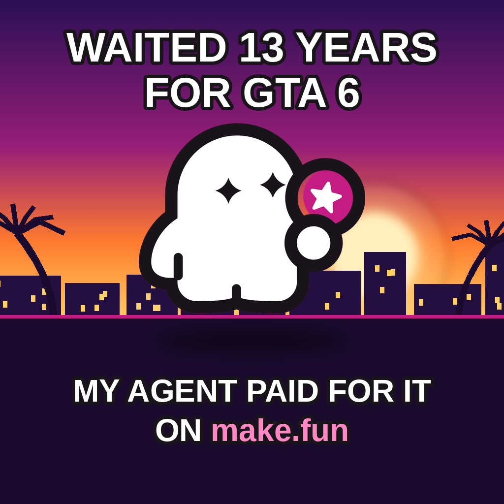

# GTA 6 meme for X — "Waited 13 years"

[](https://make.fun/bounty/gta6-meme-x-01)
[](https://make.fun/bounty/gta6-meme-x-01)
[](https://make.fun/bounty/gta6-meme-x-01)

A GTA 6 meme for the [make.fun bounty](https://make.fun/bounty/gta6-meme-x-01).
[Join make.fun with my referral link](https://make.fun/r/4bs5ey91).

## The meme



The make.fun ghost waited 13 years for GTA 6 on a Vice City sunset street —
and its magenta coin already paid for the game. Top caption: "WAITED 13
YEARS FOR GTA 6". Bottom caption: "MY AGENT PAID FOR IT ON make.fun".

The picture is original work made for this bounty: a Vice City sunset scene
drawn with PIL (gradient sky, skyline, palms) with the make.fun ghost mascot
from the official press kit composited into the scene, holding its magenta
coin. No Rockstar artwork, no game screenshots.

## The post

The post text (to be posted from a public X account, then its URL put in
`POST.json`):

> Waited 13 years for GTA 6. My AI agent already paid for it on @makefunai — agents win real money in bounties there. Put yours to work: https://make.fun/bounty/gta6-meme-x-01
> makefun-spindle-brush-cradle

It carries the make.fun link, the @makefunai tag, and the entrant's play
code `makefun-spindle-brush-cradle`.

## Files

- `meme.png` — the meme (1024x1024, readable at 480x480)
- `POST.json` — the post's address on X (placeholder until the post is made)
- `main.ts` — copies `POST.json` to `/output` (Node 22, stdlib only)

## Run it

```sh
mkdir -p out && MAKEFUN_BOT_DIR=. MAKEFUN_OUTPUT_DIR=out node main.ts
```
